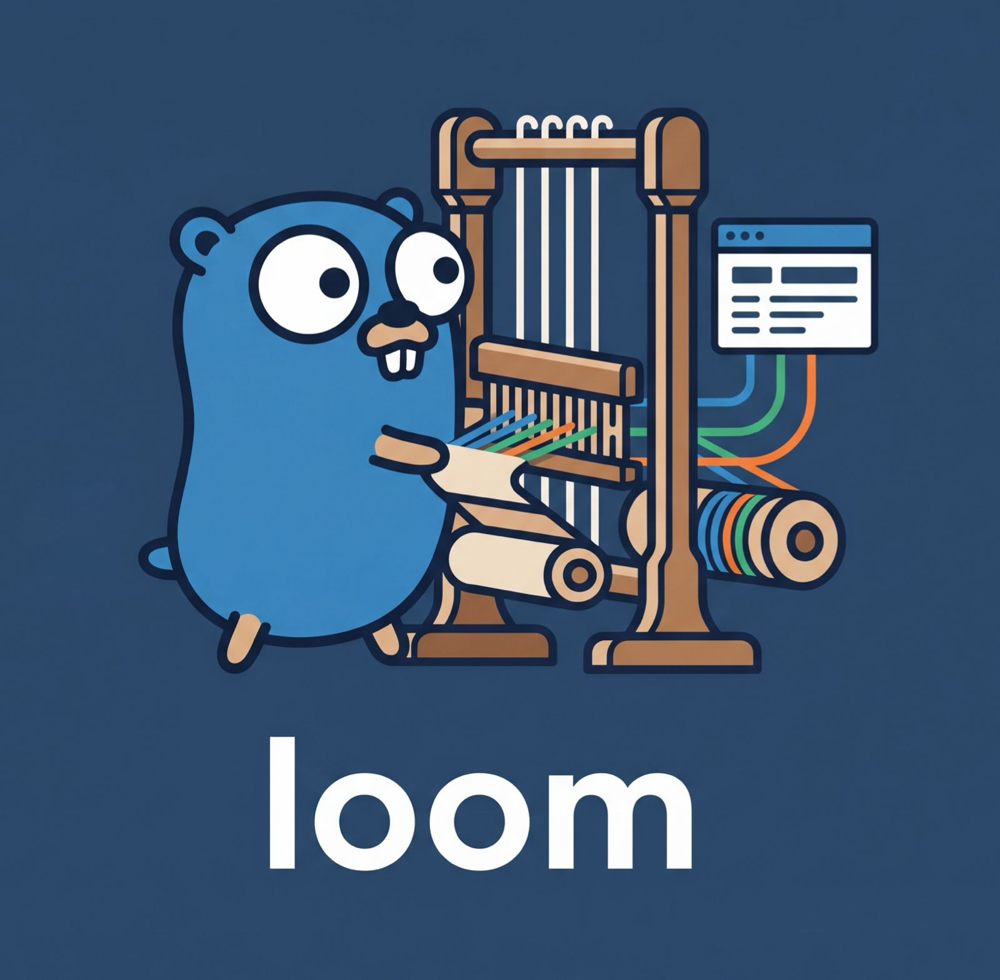

<div align="center">



# Loom

**Painel administrativo e API REST para [Goravel](https://www.goravel.dev), inspirado no [Filament](https://filamentphp.com).**

Declare formulários e tabelas em Go e o Loom gera as telas de CRUD, a navegação, o login e o dashboard. Declare campos e regras de acesso e ele gera uma API REST em JSON com autenticação por token.


</div>

---

## Sumário

- [Recursos](#recursos)
- [Como funciona](#como-funciona)
- [Instalação](#instalação)
  - [Com Docker](#com-docker)
  - [Sem Docker](#sem-docker)
- [Primeiros passos](#primeiros-passos)
- [Uso](#uso)
  - [Configurando o painel](#configurando-o-painel)
  - [Resources](#resources)
  - [Formulários](#formulários)
  - [Tabelas](#tabelas)
  - [Upload de arquivos](#upload-de-arquivos)
  - [Ganchos das páginas](#ganchos-das-páginas)
  - [Widgets e dashboard](#widgets-e-dashboard)
  - [Páginas próprias](#páginas-próprias)
  - [API REST](#api-rest)
- [Comandos](#comandos)
- [Estrutura do projeto](#estrutura-do-projeto)
- [Documentação](#documentação)
- [Licença e créditos](#licença-e-créditos)

## Recursos

- **CRUD completo**: listagem com busca, filtros, ordenação, paginação e exclusão em massa, além de formulários de criar e editar com validação.
- **Gerador pelo terminal**: `loom:make-resource Car --generate` lê as colunas da tabela e cria o resource pronto.
- **API REST**: resources de API com busca, filtros, ordenação, paginação, validação e acesso público ou privado por rota (`--api` no gerador).
- **Tokens de API** no estilo do Laravel Sanctum: permissões, validade, revogação, tela no painel, login por e-mail e senha e limite de requisições.
- **Formulários**: Text, Email, Password, Number, Textarea, Select, Toggle, Date e FileUpload, com regras de validação do Goravel e `Unique()` automático.
- **Upload de arquivos** em três modos: arquivo em disco, base64 numa coluna `text` ou bytes numa coluna `bytea`.
- **Autenticação**: login, cadastro opcional, recuperação de senha por e-mail (SMTP) e controle de acesso com `CanAccess`.
- **Dashboard** com widgets de estatísticas e gráficos (Chart.js).
- **Ganchos** nas páginas de listar, criar, editar e excluir (`BeforeCreate`, `AfterSave`, `BeforeDelete`...).
- **Tema claro, escuro ou do sistema**, cores configuráveis (20 paletas do Tailwind) e menu lateral recolhível.
- **Acessibilidade**: menu do usuário com ajuste do tamanho da fonte (85% a 150%), navegação por teclado e atributos ARIA.
- **Ícones** do [Heroicons](https://heroicons.com), usados pelo nome (`"users"`, `"heroicon-s-truck"`).
- **Segurança**: proteção CSRF, sessão renovada no login, tokens de reset com hash e uso único, e arquivos servidos com o tipo detectado pelo conteúdo.
- **Documentação embutida** em `/loom/docs`, no estilo da documentação do Filament.
- **Docker**: `docker compose up` sobe o app e o PostgreSQL.

## Como funciona

O Loom é um pacote Go (`packages/loom`) que se registra num app Goravel por um **Panel Provider**, como o `AdminPanelProvider` do Filament. Cada tabela do banco vira um **resource**: uma pasta com o formulário e a listagem declarados em Go.

```
app/providers/admin_panel_provider.go   configura o painel (/admin)
app/loom/admin/user/                    um resource
├── resource.go   URL, tabela, nomes, ícone
├── form.go       formulário de criar/editar
├── table.go      colunas, filtros e ordenação
└── pages.go      ganchos (opcional)
```

As telas usam `html/template`, Tailwind CSS e HTMX. Não há build de front-end: tudo é embutido no binário.

## Instalação

### Com Docker

Requisitos: Docker com Compose.

```bash
git clone git@github.com:PedroPaulo-98/loom-goravel.git
cd loom-goravel
cp .env.example .env
```

Gere a chave da aplicação (32 caracteres) e coloque em `APP_KEY` no `.env`:

```bash
openssl rand -hex 16
```

Suba o app e o banco:

```bash
docker compose up -d --build
```

O app fica em **http://localhost**, na porta 80. As migrations rodam sozinhas a cada subida. Para criar o primeiro administrador:

```bash
docker compose exec goravel /www/main artisan loom:make-user
```

Acesse **http://localhost/admin**.

> O `docker-compose.yml` lê o `.env`. O banco usa `DB_DATABASE`, `DB_USERNAME` e `DB_PASSWORD`, e os dados ficam nos volumes `pgdata` (banco) e `storage` (uploads, sessões e logs). Para servir em outro endereço, defina `DOCKER_APP_URL=https://seu.dominio` no `.env`.

### Sem Docker

Requisitos: Go 1.25 ou superior e PostgreSQL.

```bash
git clone git@github.com:PedroPaulo-98/loom-goravel.git
cd loom-goravel
cp .env.example .env
```

```bash
go run . artisan key:generate
```

Ajuste `DB_HOST`, `DB_PORT`, `DB_DATABASE`, `DB_USERNAME` e `DB_PASSWORD` no `.env`, depois rode:

```bash
go run . artisan migrate
```

```bash
go run . artisan loom:make-user
```

```bash
go run .
```

O painel fica em **http://localhost:3000/admin**.

### Recuperação de senha (opcional)

Preencha `MAIL_HOST`, `MAIL_PORT`, `MAIL_USERNAME`, `MAIL_PASSWORD`, `MAIL_FROM_ADDRESS` e `MAIL_FROM_NAME` no `.env`, e `APP_URL` com o endereço público do app, que é usado no link do e-mail. Para testar localmente, o [Mailpit](https://mailpit.axllent.org) funciona bem.

## Primeiros passos

Crie a tabela com uma migration:

```bash
go run . artisan make:migration create_cars_table
```

```go
func (r *M20261116000000CreateCarsTable) Up() error {
	return facades.Schema().Create("cars", func(table schema.Blueprint) {
		table.ID()
		table.String("brand")
		table.String("model")
		table.Integer("year")
		table.Boolean("available").Default(true)
		table.TimestampsTz()
	})
}
```

```bash
go run . artisan migrate
```

Gere o resource a partir da tabela:

```bash
go run . artisan loom:make-resource Car --generate --label=Carros --singular=Carro --icon=truck
```

O comando cria `app/loom/admin/car/` e registra o resource no `AdminPanelProvider`. Reinicie o app e **Carros** aparece no menu, com listagem, busca, filtros e formulário.

## Uso

### Configurando o painel

Tudo fica em [`app/providers/admin_panel_provider.go`](app/providers/admin_panel_provider.go):

```go
func (r *AdminPanelProvider) Panel(panel *loom.Panel) *loom.Panel {
	return panel.
		ID("admin").
		Path("/admin").
		BrandName("Minha Empresa").
		BaseURL(facades.Config().GetString("app.url")).
		DefaultThemeMode(loom.ThemeSystem).
		MaxContentWidth("full").
		Colors(map[string]color.Palette{
			"primary": color.Sky,
			"gray":    color.Slate,
		}).
		NavigationGroups("Cadastros", "Administração").
		Registration(map[string]any{"role": "user"}).
		PasswordReset().
		CanAccess(func(u table.Row) bool {
			return table.Stringify(u["role"]) == "admin"
		}).
		Resources(&user.Resource{}, &car.Resource{}).
		Widgets(widgets.UsersOverview()).
		SidebarCollapsibleOnDesktop()
}
```

| Método | Para que serve |
|---|---|
| `Path("/admin")` | URL do painel. |
| `BrandName(...)` | Nome no topo e no título da aba. |
| `Colors(...)` | Cores de `primary`, `gray`, `danger`, `success`, `warning` e `info`. |
| `DefaultThemeMode(...)` | `ThemeLight`, `ThemeDark` ou `ThemeSystem`. |
| `Registration(defaults)` | Liga o "Criar conta" no login. |
| `PasswordReset()` | Liga o "Esqueceu a senha?" (precisa de SMTP). |
| `CanAccess(fn)` | Quem pode entrar no painel. |
| `Middleware(...)` / `AuthMiddleware(...)` | Middlewares do Goravel em todas as rotas ou só nas autenticadas. |
| `Routes(fn)` | Rotas próprias dentro do painel. |
| `Plugin(...)` | Pacotes que adicionam resources, páginas e widgets. |

### Resources

```go
package car

import "goravel/packages/loom"

type Resource struct {
	loom.BaseResource
}

func (Resource) Slug() string            { return "cars" }
func (Resource) TableName() string       { return "cars" }
func (Resource) Label() string           { return "Carros" }
func (Resource) SingularLabel() string   { return "Carro" }
func (Resource) Icon() string            { return "truck" }
func (Resource) NavigationGroup() string { return "Cadastros" }
```

### Formulários

```go
func (Resource) Form(f *form.Form) {
	f.Schema(
		form.Text("brand").Label("Marca").Required().Rules("max:100"),
		form.Text("model").Label("Modelo").Required(),
		form.Number("year").Label("Ano").Required().Rules("min:1950"),
		form.Select("fuel").Label("Combustível").
			Option("flex", "Flex").
			Option("diesel", "Diesel").
			Option("electric", "Elétrico"),
		form.Toggle("available").Label("Disponível").Default("true"),
		form.Textarea("notes").Label("Observações").Nullable(),
	)
}
```

Os modificadores são `Required()`, `Unique()`, `Nullable()`, `Rules(...)`, `Default(...)`, `Placeholder(...)`, `Help(...)`, `OnlyOnCreate()` e `ColumnSpanFull()`.

### Tabelas

```go
func (Resource) Table(t *table.Table) {
	t.Columns(
		table.Image("photo").Label("Foto"),
		table.Text("brand").Label("Marca").Sortable().Searchable(),
		table.Text("model").Label("Modelo").Sortable().Searchable(),
		table.Badge("fuel", map[string]string{"electric": "success", "diesel": "gray"}).Label("Combustível"),
		table.Boolean("available").Label("Disponível"),
		table.DateTime("created_at").Label("Criado em").Sortable(),
	).Filters(
		table.SelectFilter("available").Label("Status").
			Option("true", "Disponível").
			Option("false", "Indisponível"),
	).DefaultSort("created_at", "desc").PerPage(25)
}
```

As colunas disponíveis são `Text`, `Boolean`, `DateTime`, `Badge`, `Image` e `FileLink`. Para formatar valores, use `Format("...")` ou `FormatUsing(func)`.

### Upload de arquivos

```go
form.FileUpload("photo").Image().Directory("cars").MaxSize(2048)                 // arquivo em storage/app/cars, caminho numa coluna varchar
form.FileUpload("manual").StoreAsBase64().AcceptedFileTypes("application/pdf")  // data URI numa coluna text
form.FileUpload("invoice").StoreAsBinary().AcceptedFileTypes("application/pdf") // bytes numa coluna bytea
```

- **Tipo pelo conteúdo**: o tipo é detectado pelos bytes do arquivo, não pela extensão.
- **Disco sempre limpo**: trocar o arquivo, removê-lo ou excluir o registro apaga o arquivo antigo do disco.
- **Entrega segura**: os arquivos são servidos numa rota que exige login. Só imagens e PDF abrem no navegador; o resto é baixado.

### Ganchos das páginas

Métodos opcionais no resource, gerados comentados em `pages.go`:

```go
func (Resource) ModifyListQuery(ctx loom.Context, q contractsdb.Query) contractsdb.Query {
	return q.Where("available", true)
}

func (Resource) BeforeCreate(ctx loom.Context, data map[string]any) error {
	data["created_by"] = ctx.User()["id"]
	return nil
}

func (Resource) BeforeDelete(ctx loom.Context, ids []any) error {
	return loom.Halt("Carros não podem ser excluídos.")
}
```

Também existem `AfterCreate`, `BeforeSave` e `AfterSave`. Um gancho que retorna `loom.Halt("mensagem")` cancela a ação e mostra a mensagem ao usuário.

### Widgets e dashboard

```go
func CarsOverview() *loom.StatsOverviewWidget {
	return &loom.StatsOverviewWidget{
		Stats: func(ctx loom.Context) ([]loom.Stat, error) {
			total, err := ctx.DB().Table("cars").Count()
			if err != nil {
				return nil, err
			}
			return []loom.Stat{
				{Label: "Carros", Value: strconv.FormatInt(total, 10), Icon: "truck"},
			}, nil
		},
	}
}
```

Além das estatísticas, o `ChartWidget` gera gráficos de barra, linha, pizza, rosca, área polar e radar.

### Páginas próprias

```go
type Reports struct{ loom.BasePage }

func (Reports) Slug() string  { return "reports" }
func (Reports) Title() string { return "Relatórios" }
func (Reports) Icon() string  { return "chart-bar" }

func (Reports) Content(ctx loom.Context) (template.HTML, error) {
	return ctx.Panel.RenderWidgets(ctx, []loom.Widget{CarsOverview()})
}
```

Registre com `Pages(&Reports{})`. A página ganha o menu, o tema e o login do painel.

### API REST

Gere um resource de API a partir da tabela:

```bash
go run . artisan loom:make-resource Car --api --generate
```

```go
func (Resource) Access() api.Access {
	return api.Access{
		Index:   api.Public(),            // GET    /api/v1/cars
		Show:    api.Public(),            // GET    /api/v1/cars/{id}
		Store:   api.Can("cars:write"),   // POST   /api/v1/cars
		Update:  api.Can("cars:write"),   // PUT    /api/v1/cars/{id}
		Destroy: api.Can("cars:delete"),  // DELETE /api/v1/cars/{id}
	}
}

func (Resource) Fields(s *api.Schema) {
	s.Schema(
		api.Field("brand").Required().Rules("max:100").Searchable().Sortable(),
		api.Field("year").Integer().Required().Filterable().Sortable(),
		api.Field("available").Boolean().Filterable(),
		api.Field("cost_price").Number().Hidden(),
		api.Field("created_at").DateTime().ReadOnly().Sortable(),
	)
}
```

- **Acesso**: `api.Public()` dispensa token, `api.Authenticated()` aceita qualquer token e `api.Can("cars:write")` exige a permissão. Rotas não declaradas exigem token.
- **Listagem**: aceita `?search=gol&filter[year]=2020,2021&sort=-price&page=2&per_page=20` e responde `{"data": [...], "meta": {...}}`.
- **Erros**: vêm em JSON com status claros: `401`, `403`, `404`, `422` (com os erros de cada campo) e `429`.

Os tokens são enviados em `Authorization: Bearer <token>` e criados de três formas:
- pela tela **Tokens de API** do painel;
- pelo comando `loom:make-token`;
- por `POST /api/v1/auth/token`, com e-mail e senha.

A configuração fica em [`app/providers/api_provider.go`](app/providers/api_provider.go).

Exemplo com curl:

```bash
curl http://localhost:3000/api/v1/users?per_page=5 -H "Authorization: Bearer SEU_TOKEN"
```

## Comandos

| Comando | O que faz |
|---|---|
| `go run . artisan loom:make-user` | Cria um usuário administrador. Aceita `--name`, `--email` e `--password`, ou pergunta cada um. |
| `go run . artisan loom:make-resource Car` | Cria o resource com `resource.go`, `form.go`, `table.go` e `pages.go`, e o registra no painel. |
| `go run . artisan loom:make-resource Car -g` | O mesmo, montando o formulário e a tabela a partir das colunas do banco. |
| `go run . artisan loom:make-resource Car --api -g` | Cria um resource de API REST e o registra no `APIProvider`. |
| `go run . artisan loom:make-token --email=... --abilities="cars:*"` | Cria um token de API. Também aceita `--name` e `--days`. |

O `loom:make-resource` também aceita `--table`, `--slug`, `--label`, `--singular`, `--icon`, `--group`, `--no-register` e `--force`.

## Estrutura do projeto

```
.
├── app/
│   ├── loom/admin/           resources e widgets do painel /admin
│   ├── loom/api/             resources da API /api/v1
│   └── providers/            AdminPanelProvider e APIProvider
├── database/migrations/      users, password_reset_tokens, api_tokens, colunas de upload
├── packages/loom/            o Loom
│   ├── api/                  campos e regras de acesso da API
│   ├── color/                paletas de cores
│   ├── docs/                 site de documentação (/loom/docs)
│   ├── form/                 campos de formulário e upload
│   ├── heroicons/            ícones SVG embutidos
│   ├── table/                colunas e filtros
│   └── views/                templates HTML do painel
├── Dockerfile
└── docker-compose.yml
```

## Documentação

Com o app rodando, a documentação completa fica em **`/loom/docs`**: instalação, configuração do painel, resources, gerador, tabelas, formulários, upload, cores e tema, ícones, autenticação, recuperação de senha, widgets, páginas, plugins e middleware, além de resources de API e autenticação da API.

As páginas são arquivos Markdown em [`packages/loom/docs/content`](packages/loom/docs/content).

## Licença e créditos

Distribuído sob a licença [MIT](LICENSE).

- **[Goravel](https://www.goravel.dev)**: framework e esqueleto da aplicação (MIT).
- **[Filament](https://filamentphp.com)**: inspiração para a API e o visual.
- **[Heroicons](https://heroicons.com)**: ícones (MIT, veja [`packages/loom/heroicons/LICENSE`](packages/loom/heroicons/LICENSE)).
- **[Tailwind CSS](https://tailwindcss.com)**, **[HTMX](https://htmx.org)** e **[Chart.js](https://www.chartjs.org)**: front-end, carregados via CDN.
